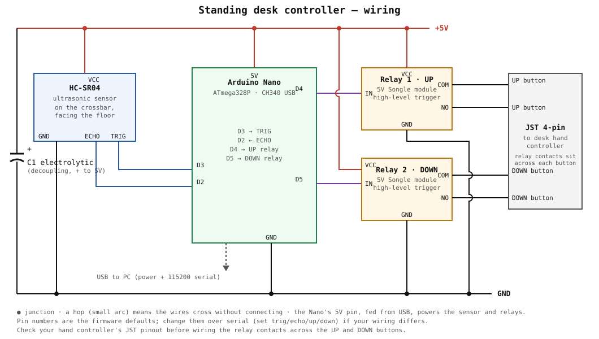

# Standing desk controller

An Arduino Nano moves a motorized standing desk to a requested height. A PC controls the Nano over USB serial. An Omarchy bar widget gives a graphical front end.



Two 5 V relay modules connect across the UP and DOWN buttons of the hand controller of the desk. The Nano closes a relay to press a button. An HC-SR04 ultrasonic sensor hangs from the desk crossbar and measures the distance to the floor.

The firmware runs a closed loop. It closes a relay, reads the height, and opens the relay a short distance before the target. The desk then coasts to the target. If the desk stops outside the tolerance, the firmware makes a correction.

## Hardware

| Part | Connection |
|------|------------|
| Arduino Nano (ATmega328P, CH340) | USB to the PC. The 5 V pin supplies the other parts. |
| HC-SR04 | VCC to 5 V, GND to GND, TRIG to D3, ECHO to D2 |
| Relay 1 (UP) | VCC to 5 V, GND to GND, IN to D4, COM and NO across the UP button |
| Relay 2 (DOWN) | VCC to 5 V, GND to GND, IN to D5, COM and NO across the DOWN button |
| Electrolytic capacitor | Across 5 V and GND, for decoupling |

A 4-pin JST connector carries the relay contacts to the hand controller. Before you wire the relays, measure the pinout of your hand controller with a multimeter. Each button is a pair of lines. The button shorts the pair when you press it. The relay modules in this build are high-level trigger (`activelow 0`). For low-level trigger modules, set `activelow 1`.

The pin numbers in the firmware are defaults. If your wiring is different, change the pins over serial (`set trig 3`, `set echo 2`, and so on) and then `save`. The `scan` command finds the sensor on any pin pair. The `pulse` command shows which pin controls which relay.

## Repository layout

- `firmware/desk_controller/desk_controller.ino` is the sketch.
- `desk.py` is the host CLI and interactive shell over USB serial. It uses the Python standard library only.
- `prog.py` is a STK500v1 programmer for boards with a defective USB auto-reset. It also uses the standard library only.
- `flash.sh` is an avrdude flasher for boards whose auto-reset works.
- `omarchy-plugin/nerdyworm.desk/` is the Omarchy bar widget.
- `build/desk_controller.ino.hex` is the compiled firmware.
- `docs/schematic.svg` is the wiring diagram.

## Build and flash

```
arduino-cli core install arduino:avr
arduino-cli compile --fqbn arduino:avr:nano:cpu=atmega328 --output-dir build firmware/desk_controller
./flash.sh
```

For a Nano with the old 57600 baud bootloader, use `cpu=atmega328old`.

If avrdude reports "not in sync" at both baud rates, the USB auto-reset of the board is probably defective. The board in this build has this fault. The `prog.py` tool waits for a manual reset instead:

```
./prog.py --baud 115200 --wait 90 build/desk_controller.ino.hex
```

1. Start `prog.py`.
2. Tap the reset button on the Nano one time every two seconds.
3. When the tool shows `SYNC OK`, release the board.

The tool saves the current flash to `backup/`, writes the new firmware, and verifies it.

On Linux, your user needs access to the serial device. Usually this means membership of the `uucp` or `dialout` group.

## Serial protocol

The speed is 115200 baud. Send one command per line. Replies start with `OK`, `ERR`, `H`, `STATUS`, `CFG`, `DONE`, or `STOP`. The board prints `READY` after boot.

```
h | height          read height (cm)
status | cfg        show state / configuration
sit | stand         go to preset
go <cm>             go to height
stop                release relays, cancel target
up [ms] | down [ms] pulse a relay (default 500, max 3000)
pulse <pin> [ms]    pulse any pin 2-12 (to find relay wiring)
probe               auto-detect trig/echo order
scan                find the sensor on any pin pair
set <key> <val>     trig echo up down activelow offset sit stand tol earlyup earlydown maxmove
save | load | defaults
```

During a move, the board sends `H <cm>` lines. The move ends with `DONE <cm>` or `STOP <reason>`. The configuration is in EEPROM with a magic number, a version, and a CRC. If the configuration is absent or corrupt, the firmware uses the defaults.

A height is the distance that the sensor measures. By default this is the distance from the crossbar to the floor. To work in desktop height, set `offset` to the difference between the two.

## Host CLI

```
./desk.py stand
./desk.py sit
./desk.py go 95
./desk.py h
./desk.py stop          # Ctrl-C during a move also sends stop
./desk.py shell         # interactive console
./desk.py pipe          # long-lived bridge for the bar widget
```

The tool finds `/dev/ttyUSB*` by itself. Set `DESK_PORT` to select a different port. The tool opens the port with HUPCL off, so a new connection does not reset the Nano.

## Calibration

```
./desk.py shell
> scan                  # confirm the sensor pins
> pulse 4 1500          # close a relay for 1.5 s and see which way the desk moves
> set sit 72
> set stand 110
> save
```

If the desk stops short of the target or goes past it, adjust `earlyup` and `earlydown`. These values are the distance in cm before the target at which the firmware opens the relay. Then `save`. The first part of a move uses this margin. Corrections do not.

## Omarchy bar widget

`omarchy-plugin/nerdyworm.desk/` is a bar widget for the [Omarchy](https://omarchy.org) shell.

1. Copy the directory to `~/.config/omarchy/plugins/nerdyworm.desk/`.
2. If `desk.py` is not at `~/code/computer/desk/desk.py`, set `DESK_CLI` to its path.
3. Run `omarchy-shell shell rescanPlugins`.
4. Run `omarchy plugin enable nerdyworm.desk`.

The bar label shows the current height. A left click opens a panel. The panel has sit and stand presets, up and down nudges, stop, and go-to-height. It also has buttons that save the current height as a preset. A right click moves to the other preset. A middle click stops the desk.

The widget keeps the serial port open through `desk.py pipe`. Before you use `desk.py` or `prog.py` directly, run `omarchy plugin disable nerdyworm.desk` to release the port.

The widget has an IPC interface for keybinds:

```
omarchy-shell nerdyworm.desk sit|stand|togglePreset|go <cm>|stop|status
```

## Safety in the firmware

- The firmware sets each relay pin to the inactive level before it makes the pin an output. Nothing moves at boot.
- The firmware never closes both relays at the same time. It opens one relay, waits 20 ms, and then closes the other.
- A move stops after `maxmove` ms (default 25 s), after five bad sensor reads, or on `stop`.
- The manual `up`, `down`, and `pulse` commands stop after 3 s at most.

## License

MIT
